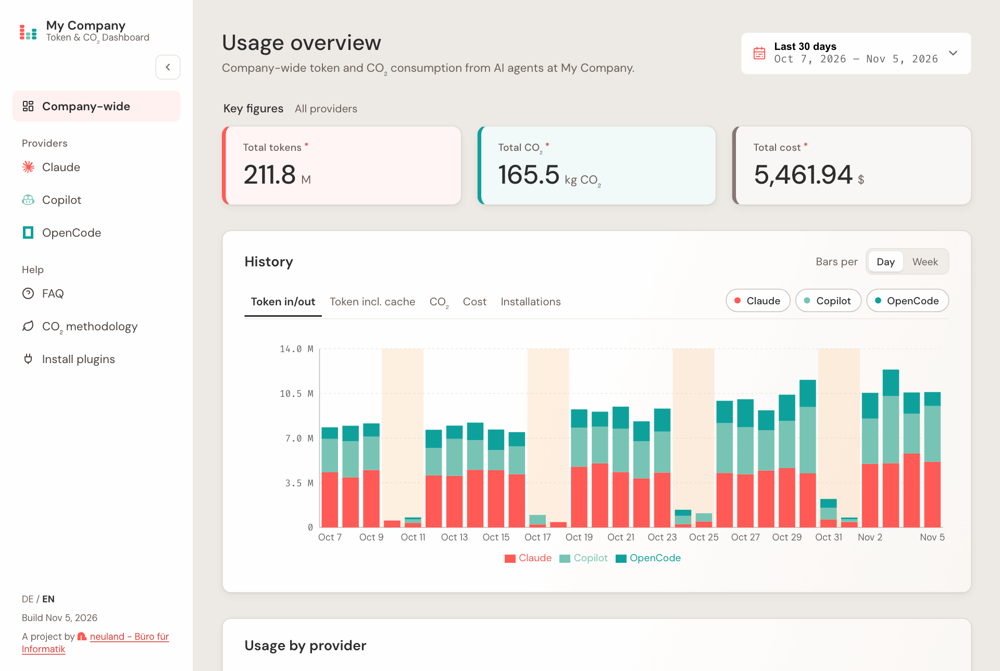

# TokenDashboard

Company-wide dashboard for token usage, estimated cost and estimated CO₂ emissions
across AI providers (Claude Code, GitHub Copilot, OpenCode).



| Folder | What | Docs |
| --- | --- | --- |
| [`backend/`](backend/) | Ktor/Kotlin API with PostgreSQL | [README](backend/README.md), [CONTRIBUTING](backend/CONTRIBUTING.md) |
| [`frontend/`](frontend/) | Astro + React static site | [README](frontend/README.md), [CONTRIBUTING](frontend/CONTRIBUTING.md) |

The data comes from at least one plugin, each in its own repository:

- Claude: https://github.com/neuland/tokendashboard-plugin-claude
- Copilot: https://github.com/neuland/tokendashboard-plugin-copilot
- OpenCode: https://github.com/neuland/tokendashboard-plugin-opencode

Backend and frontend were separate repositories until they were merged here with their
full history; `git log -- backend/` or `git log -- frontend/` shows the history of one
side.

## Try it out

[`docker-compose.yml`](docker-compose.yml) builds both images from this checkout and
starts them with a database:

```bash
docker compose up --build
```

The dashboard then runs on <http://localhost:8088>; point the plugins at the same
address. `PUBLIC_COMPANY_NAME`, `DATABASE_PASSWORD` and `TOKENDASHBOARD_PORT` can be set
in the shell or in a `.env` next to the file. Needs Docker Compose 2.23 or newer.

### Claude Code in a devcontainer

Keep this in mind when trying it out with a local backend, whether started with
`docker compose up` or with `./gradlew run` in `backend/`: if Claude Code runs in a
devcontainer of your own that mounts `~/.claude`, it may not reach the backend, since
`localhost` inside the container is the container itself. Nothing is lost, but the
entries wait in the plugin's queue and are only sent the next time a Claude Code session
on the host starts or ends.

This repository's [devcontainer](.devcontainer/) solves this with port forwarding:
`localhost:8088` (the compose stack) and `localhost:8080` (`./gradlew run` on the host)
inside the container lead to the host, so the same `--api-base-url` works on both sides.
Port 8080 is therefore taken inside that container.

## Development

Each side is built from its own folder (`./gradlew …` in `backend/`, `npm …` in
`frontend/`). The [devcontainer](.devcontainer/) covers both (JDK 25, Node 24,
Playwright); `just claude` starts Claude Code inside it.

## CI

GitHub Actions runs [`.github/workflows/backend.yml`](.github/workflows/backend.yml)
and [`.github/workflows/frontend.yml`](.github/workflows/frontend.yml), each only when
its folder changed. Neither builds or publishes an image — how and where the images are
deployed is up to each installation (see the `examples/` folder on each side).
